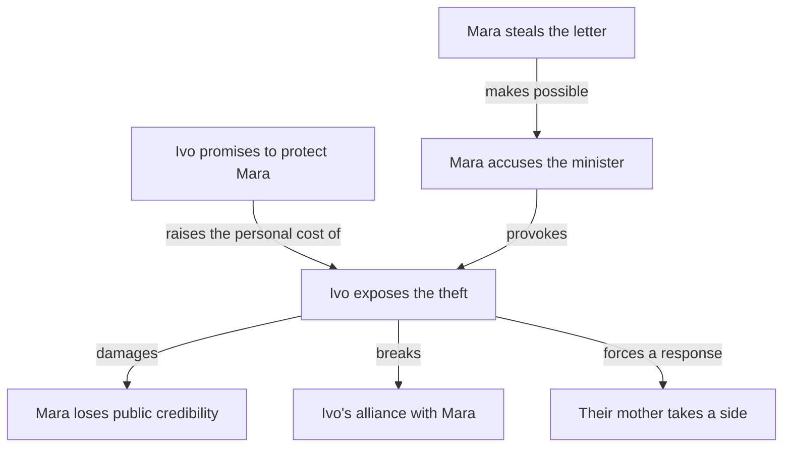

# Story-map proposal

Working concept from the September 15, 2026 discussion. This is an exploration of
a possible skill, not an implemented architecture. See also the
[fiction skill ideas](skill-ideas.md).

## Purpose

Help an author ideate, track, and reason about plot structure as a graph, especially
in ensemble stories where characters have individual arcs that intersect.

Potential uses include outlining, experimenting with alternate plots, tracing
revision consequences, checking consistency, and assembling focused context for
other skills. It should support rough possibilities as well as established drafts.

## Graph structure and DAGs

A directed acyclic graph, or DAG, has directed connections with no circular paths.
It can represent dependencies, such as an event that must happen before another
becomes possible. The entire story should not be forced into one DAG.

Connections need explicit meanings:

| Connection | Example | Proposed treatment |
| --- | --- | --- |
| Event order | Theft happens before trial. | Usually acyclic within a consistent timeline. |
| Causal dependency | A stolen letter provides evidence for an accusation. | Usually acyclic; stories with time travel may differ. |
| Narrative order | The reader sees the trial before learning about the theft. | Keep presentation order separate from event order. |
| Knowledge dependency | Recognizing a forgery requires learning who wrote the letter. | Usually acyclic for specific learning events. |
| Character relationship | Mara distrusts Ivo; Ivo depends on Mara. | Reciprocal connections are valid. |
| Echo or contrast | A late act of mercy recalls earlier cruelty. | No DAG requirement. |

Start with the dependencies needed for an actual task. Add other connection types
when useful. Apply cycle checks only to relations where circularity would violate
the story's rules. A causal loop may be a mistake in one story and a premise in another.

## Events as intersections of arcs

Center the plot map on events or meaningful beats. Trace character arcs through
shared events rather than duplicating an event in separate character outlines.

Example:

> During the hearing, Ivo reveals that Mara stole the letter.

The same event can destroy Mara's credibility, mark Ivo choosing public duty over
loyalty, and expose a family conflict their mother has concealed. Participation and
consequence differ by character.

This is an illustrative graph, not a proposed formal vocabulary. In particular,
the promise changes the meaning of Ivo's action; it does not cause the disclosure.

Keep events separate from scenes. A scene presents material and may contain several
events, revisit an earlier event, or show another character experiencing the same
event. Rearranging the telling must not silently rearrange what happened.

## Operations to explore

### Discover connections

Start with disconnected things the author wants, such as a betrayal at a hearing,
a failed reunion, and someone winning an argument but losing a relationship.
Explore possible dependencies without committing to one version prematurely.

Does the reunion cause the betrayal, or does the betrayal cause the reunion to fail?
What must be established beforehand for the betrayal to have the intended effect?

The graph identifies consequential unresolved choices. `grill-my-story` can help
the author investigate them.

### Trace intersecting arcs

Distinguish sharing a scene from changing one another's available choices. Look
for who acts, who responds, and whose decisions affect another arc.

Possible observations include one character driving another's arc without any
reciprocal effect, simultaneous crises that remain unrelated, or an apparent
subplot containing the choice that enables the climax.

These are questions for editorial investigation. Independent arcs can be deliberate;
the skill should not automatically prescribe tighter connections.

### Follow a change

For “What if Ivo learns about the theft two chapters earlier?”, trace:

- Later actions that depend on his ignorance.
- Conversations whose meaning changes.
- Whether the hearing still surprises him.
- What readers can infer from his silence.
- Story-bible claims and outline entries needing reassessment.

Distinguish direct conflicts, possible consequences, and material worth rereading.
Graph reachability identifies where to look; it does not prove every connected
scene requires rewriting.

### Assemble focused context

For a particular writing task, retrieve relevant characters, knowledge at that
point, earlier commitments or injuries, dependencies, intended later preparations,
and unresolved choices.

Respect the packet's purpose and spoiler boundary. Revision planning can use future
revelations; an independent first-reader pass cannot.

Plot connections do not capture every relevant detail. Voice, atmosphere, recurring
images, and small relationship beats may matter without being causal prerequisites.
Use the graph to guide retrieval back to source material and state what a packet omits.

### Check consistency and assess structure

Potential concrete checks:

- A character uses information before any established opportunity to learn it.
- Ordering constraints are mutually incompatible.
- A planned payoff depends on a removed setup.
- Mutually exclusive alternatives are both treated as current.
- A graph claim has lost its manuscript support after revision.

Editorial observations require separate judgment: an emotional turn may lack
preparation, an arc may disappear for a long stretch, or a climax may depend on
coincidence more than intended. The graph can check recorded constraints; it cannot
certify that a story works. Incomplete records also limit what checks can establish.

## Uncertainty, alternatives, and evidence

Reuse the story bible's claim statuses and provenance rules. Connections themselves
need status and evidence: “the reunion causes the betrayal” may be an author decision,
a working hypothesis, or a reading of the draft.

Preserve alternatives such as deliberate exposure versus accidental disclosure while
defending someone. Make mutually exclusive possibilities and shared experimental
versions distinguishable. Do not treat all explored events as happening together.

The exact representation of alternatives remains open. A diagram must not imply more
certainty than the underlying material supports.

## Relationship to existing and proposed skills

| Skill | Relationship to the map |
| --- | --- |
| `story-bible` | Supplies underlying claims, sources, decisions, and uncertainty. |
| `grill-my-story` | Investigates consequential unresolved choices. |
| `follow-the-change` | Traces dependencies and material needing reassessment. |
| `developmental-editor` | Compares intended structure with the reading experience. |
| `try-the-scene` | Explores ways to realize a beat and its consequences. |

`story-map` would explore and maintain connections while the story bible remains
the home of underlying claims and evidence. Avoid a second independently maintained
account of the story. Expose disagreements rather than silently choosing one source.
How the map is stored alongside or within the chosen reference destination is undecided.

## Views

Show the relevant portion on demand. Useful views may include one character's arc,
an event and its consequences, intersections between selected arcs, or two alternative
plots. A whole-novel diagram with hundreds of arrows is unlikely to be a useful default.

## Proposed first prototype

Use one tangled stretch of an ensemble story, roughly three characters and eight
to twelve significant events. Test four tasks:

1. Map current events and the dependencies the author cares about.
2. Trace each character's choices and consequences through those events.
3. Explore one alternative without overwriting the current version.
4. Follow one proposed change and produce a focused context packet.

Evaluate whether the representation helps the author think and return to writing
with clearer intentions. Choose storage and visualization tools after observing
which questions are useful. No graph database, custom UI, or formal schema has been selected.

## Open questions

- What level of event or beat detail is useful in practice?
- Which connections need explicit recording, and which can remain prose?
- How should uncertain dependencies and mutually exclusive versions be represented?
- How can map maintenance fit the existing story-bible workflow without duplicate work?
- Which checks can be reliable given incomplete outlines or manuscripts?
- How should context retrieval include relevant material outside plot dependencies?
- Which views best support writing, revision, and comparison?

The intended experience is to move between scales: investigate why a betrayal feels
wrong, examine nearby choices and dependencies, try another version, then return to
the scene with a clearer sense of what it needs to accomplish.
